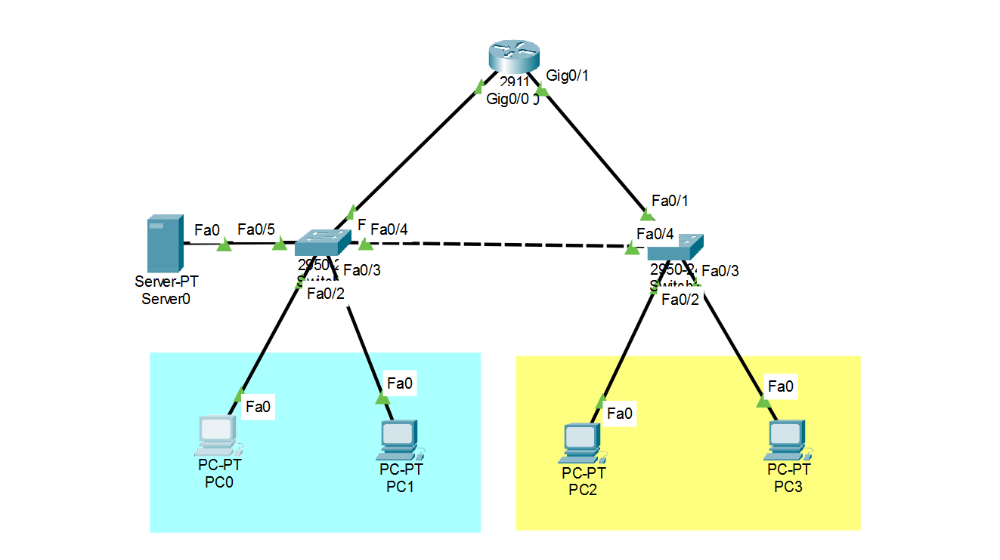
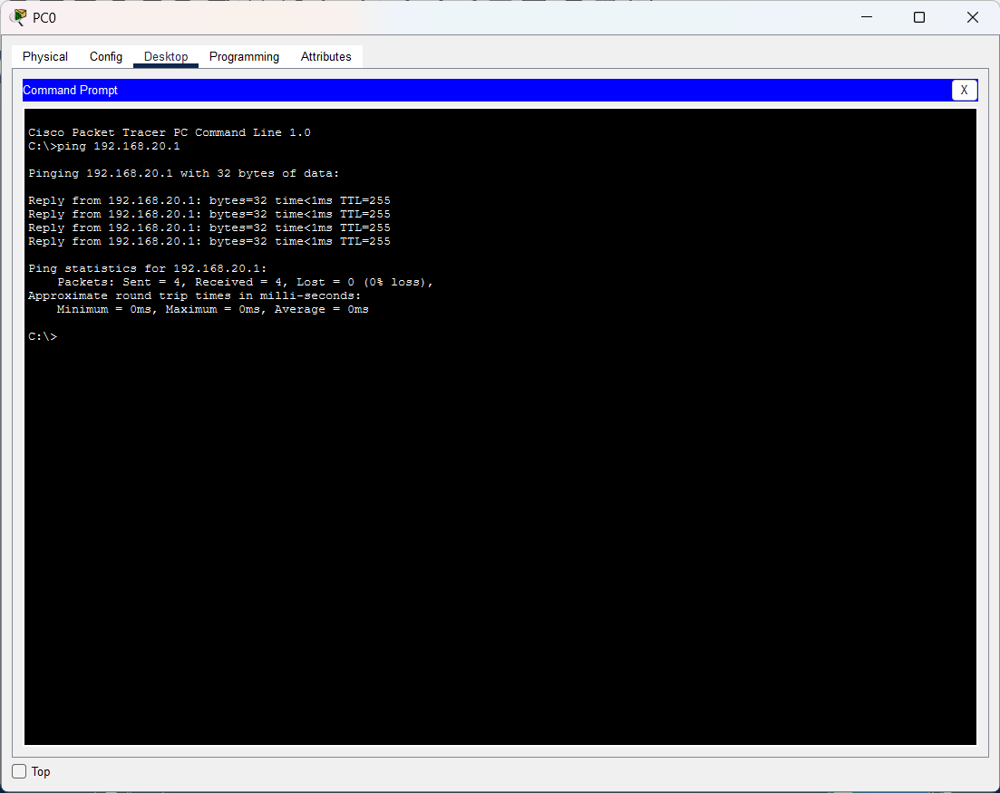

# Small Office Network Design & Configuration

## Overview

This project designs and configures a small office network in Cisco Packet Tracer. The IT and HR departments are separated into different VLANs, and communication between them is provided by inter-VLAN routing on a router (Router-on-a-Stick).

The project demonstrates practical networking concepts: IP addressing, network segmentation, trunking, DHCP, DNS, and connectivity troubleshooting.

## Objectives

- Design a small office network topology.
- Separate the IT and HR departments using VLANs.
- Configure 802.1Q trunk links between the switches and the router.
- Enable communication between VLANs using inter-VLAN routing.
- Configure DHCP for automatic IP address assignment.
- Configure DNS name resolution.
- Test connectivity and verify the configuration.

## Network Topology

| Device | Quantity | Purpose |
|---|---:|---|
| Cisco 2911 Router (`R1`) | 1 | Inter-VLAN routing, default gateway, and DHCP |
| Cisco Catalyst 2950-24 Switch (`SW-IT`, `SW-HR`) | 2 | Connecting and managing network devices |
| PC | 4 | Representing IT and HR users |
| Server | 1 | DNS server (static IP 192.168.10.10) |

## Network Segmentation

| VLAN | Department | Network | Gateway | Devices |
|---|---|---|---|---|
| 10 | IT | 192.168.10.0/24 | 192.168.10.1 | PC0, PC1, Server0 |
| 20 | HR | 192.168.20.0/24 | 192.168.20.1 | PC2, PC3 |

Each department is a separate broadcast domain. Traffic between the two VLANs is routed by the router.

## Implementation Details

### VLAN Configuration

- Created VLAN 10 (IT) and VLAN 20 (HR) on both switches.
- Assigned access ports to their VLANs:
  - `SW-IT` (left switch): `Fa0/2`, `Fa0/3` (PCs) and `Fa0/5` (server) in VLAN 10.
  - `SW-HR` (right switch): `Fa0/2`, `Fa0/3` (PCs) in VLAN 20.

### Switch Trunking

- `Fa0/4` on each switch forms an 802.1Q trunk between the two switches.
- `Fa0/1` on each switch is an 802.1Q trunk toward the router (`Gig0/0` and `Gig0/1`). Routing for both VLANs is done on `Gig0/0`; the `Gig0/1` link is an additional, unused path.
- VLANs 10 and 20 are carried and in the spanning-tree forwarding state on the trunks.

### Inter-VLAN Routing (Router-on-a-Stick)

- The router uses sub-interfaces on `GigabitEthernet0/0`:
  - `Gig0/0.10`: 192.168.10.1 (VLAN 10 gateway)
  - `Gig0/0.20`: 192.168.20.1 (VLAN 20 gateway)
- Each router sub-interface acts as the default gateway for its VLAN.

### DHCP Configuration

- DHCP is served by the router, with one pool per VLAN:

| Pool | Network | Default gateway | DNS server |
|---|---|---|---|
| IT | 192.168.10.0/24 | 192.168.10.1 | 192.168.10.10 |
| HR | 192.168.20.0/24 | 192.168.20.1 | 192.168.10.10 |

- The gateway addresses (192.168.10.1 and 192.168.20.1) are excluded from the pools.
- All four PCs use DHCP and receive their IP address, gateway, and DNS settings automatically.
- Verified that clients received valid addresses and network settings.

### DNS Configuration

- The DNS service runs on the server (192.168.10.10) and is handed to clients through DHCP.
- Added the A record `server.lab` pointing to 192.168.10.10.
- Tested name resolution from a client.

### Server Configuration

- Static IP address 192.168.10.10/24 in VLAN 10, default gateway 192.168.10.1, DNS 192.168.10.10.
- Verified the server's connectivity.

### Basic Device Hardening

- Gave the devices descriptive hostnames: `R1`, `SW-IT`, and `SW-HR`.
- Protected privileged EXEC mode with an encrypted `enable secret` on the router and both switches.
- Administratively shut down unused switch ports (`Fa0/6` to `Fa0/24` on `SW-IT`, `Fa0/5` to `Fa0/24` on `SW-HR`) so that no unauthorized device can connect to them.
- Saved the configuration on all devices with `write memory`.

## Testing and Verification

- Verified that links became operational.
- Checked client IP configurations (after resolving an initial DHCP issue).
- Tested connectivity with `ping`:
  - From PC0 (IT) to the HR gateway `192.168.20.1`, confirming inter-VLAN routing.
  - From PC2 (HR) to `server.lab`, confirming DNS resolution and access to the server across VLANs.
- Re-ran the tests after applying the hardening changes to confirm that connectivity was unaffected.
- Verified VLAN and trunk status using `show vlan brief` and `show interfaces trunk`.
- Verified router interface status using `show ip interface brief`.

### Test Results

**Inter-VLAN routing:** ping from PC0 (IT) to the HR gateway `192.168.20.1`

**DNS resolution and server access:** ping from PC2 (HR) to `server.lab`

## Troubleshooting

Issues identified and resolved during implementation:

- Investigated links that initially appeared down.
- Troubleshot a DHCP issue that caused a client to receive an APIPA address (`169.254.x.x`).
- Corrected connectivity tests that used an incorrect target IP address.
- Configured the server's IP address and gateway.
- Rechecked connectivity after applying the corrections.

## Tools and Technologies

- Cisco Packet Tracer
- IPv4 addressing and subnetting
- VLANs
- 802.1Q trunking
- Inter-VLAN routing (Router-on-a-Stick)
- DHCP
- DNS
- Basic device hardening (hostnames, `enable secret`, unused port shutdown)
- Ping and connectivity testing
- Network troubleshooting

## Skills Demonstrated

- Network design and configuration
- Network segmentation
- Basic network device hardening
- IP addressing and subnetting
- Basic network services configuration
- Connectivity verification
- Troubleshooting and technical documentation

## Project Files

- `VLAN_Network_Final.pkt`: Cisco Packet Tracer project file (opens in Packet Tracer 9.0 or later).
- `screenshots/`: screenshots of the topology and test results.

##  Author

**Rawan Alotaibi**  
Computer Science | Focused on Cybersecurity & SOC Operations  
🔗 [LinkedIn Profile][[(https://www.linkedin.com/in/rawan-alotaibi)](https://www.linkedin.com/in/rawan-alotaibi-](https://www.linkedin.com/in/rawan-alotaibi-077318431/)077318431/)
